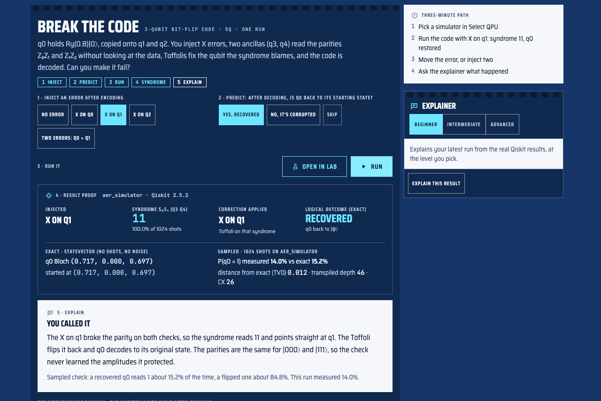

# Quantum Quest

**Learn quantum computing by experiment.** Predict what a circuit will do, run it on real Qiskit simulators (including models of IBM and IonQ machines), and explain the gap between what you expected and what happened. From an 8-year-old's first coin flip to Shor's algorithm.

*This effort is supported by Qollab & IonQ.*



| | |
|---|---|
| **Run it on Qollab** | TODO(team): Qollab project link |
| **Demo video (2–3 min)** | TODO(team): public video link |
| **Web app** | TODO(team): deployed link, or delete this row and point to [Run it](#run-it) |
| **Source** | https://github.com/Tosccony/QuantumLearning (MIT) |

## Judge it in three minutes

The Qollab project opens on **Judge Start: Break the Code**, the 3-qubit bit-flip code as a live experiment: inject an error, predict, run, read the syndrome, explain.

1. **Select a simulator.** Press **Run Project**, then **Run**, and pick any free simulator in **Select QPU**. The local ideal simulator is fastest.
2. **Run error correction.** X on q1 is already selected. Make a prediction and press **▶ Run**. Expect syndrome **11** on every shot, the correction "X on q1", the logical outcome **Recovered**, q0's Bloch vector back at (0.717, 0, 0.697), and q0 reading 1 about 15% of the time.
3. **Move the error.** X on q0 gives syndrome **10** and X on q2 gives **01**; q0 is restored both times. Now pick **Two errors**: the syndrome reads **01**, the code "fixes" q2, and q0 comes back flipped at (0.717, 0, −0.697), reading 1 about 85% of the time. A distance-3 code corrects one error, and this shows where it stops.
4. **Ask the explainer.** Press **Explain this result** for a walkthrough built from that run's numbers.

Every case is one circuit and one job, so it also runs on IonQ's simulators (press **Stop** and **Run** between jobs). The result-proof panel prints the backend, the Qiskit version, the transpiled depth and CX count, and how far the sampled counts are from the exact distribution. It keeps the exact statevector numbers separate from the sampled, possibly noisy, counts. On the IBM and IonQ noise models the syndrome drops below 100% of shots, and the panel says when the most common syndrome isn't the ideal one.

All 21 lessons are one click away under **Browse all 21 lessons**, and **Build your own circuit** opens the free Lab.

## How it fits together

```
Next.js (TypeScript, Tailwind, Framer Motion, Three.js)
 ├─ /api/tutor ─────────────► Claude API (streamed; offline fallback in the browser)
 └─ /api/qiskit/* (rewrite) ─► backend/main.py (FastAPI)
                                ├─ POST /run    validate → backend/engine.py on Qiskit Aer (+ noise model)
                                └─ /projects    community store (SQLite), re-runs on publish

qollab.xyz (runs in the browser, Pyodide)
 src/qollab/  lesson player + Lab, bundled by scripts/build-qollab.sh
   └─ quantum/engine.py (the same engine) ─► the simulator picked in Select QPU
```

## The problem

Quantum computing is usually taught in one of two ways: linear algebra on a whiteboard, or apps that animate qubits without running anything real. Either way, learners end up repeating slogans ("a qubit is 0 and 1 at the same time", "a quantum computer tries every answer at once") without being able to predict what a circuit will actually do. And almost nobody gets to see how real, noisy hardware changes the answer, even though noise is the main thing holding the field back today.

## How Quantum Quest teaches

- **Predict → Run → Explain.** Eight key lessons ask for a prediction before you run. The wrong options are the common misconceptions, and each one gets a targeted explanation, so a wrong guess becomes a lesson.
- **Every number is real.** Every circuit runs on Qiskit: Aer in the web app, and on Qollab the built-in simulator, IBM device noise models, or IonQ's Aria and Forte simulators.
- **Ideal vs this machine.** Each result is compared with the exact ideal answer, so noise becomes something you can see and measure, not a footnote.
- **One path for everyone.** Four tracks teach the same honest physics at different depths, from no maths at all to density matrices.
- **Hard topics, hands on.** Error correction (Break the Code: inject one or two errors and watch the syndrome catch them, or get fooled), BB84 quantum key distribution, the Bell test, teleportation, Grover's search and Shor's algorithm all run as circuits you can edit, with panels that do the arithmetic: the Bell score, and the factors Shor's algorithm finds.
- **A free-build Lab.** Build any circuit up to 8 qubits, or start from any lesson's circuit, and run the same circuit on an ideal simulator and on IBM and IonQ machine models to see what noise does. The results include the circuit as Qiskit code to copy.

| Track | For | Lessons |
|---|---|---|
| 🪐 Explorer | Ages 8–12, no maths | 7 planets of games with Qubit the Robot: coin flips, treasure clouds, entangled twins, a gate machine and a door race, all running real circuits |
| 🎓 Student | High school and first-year university | Qubits and measurement, superposition and interference, phase, Bell states, teleportation, Deutsch–Jozsa |
| 💻 Developer | Programmers new to quantum | Qiskit and bit ordering, transpilation, shots and noise, Grover's search, the QFT, variational circuits |
| 🔬 Researcher | Graduate level | Density matrices, noise and mitigation, the bit-flip code, phase estimation, VQE and QAOA, benchmarking |
| 🔓 Concepts | After the Student basics | BB84 quantum key distribution, the Bell test (is entanglement real?), Shor's algorithm factoring 15 |

All 21 lessons (Student, Developer, Researcher and Concepts) and the Lab run on Qollab. The Explorer games, community sharing and the Claude tutor need the full web app.

## Features

- **Learning roadmaps** (`/roadmaps`): five prerequisite-aware paths connecting the existing lessons and Explorer games to circuit experiments, credited external resources, bookmarks, notes, and completion progress. Resource review is separate from assessed lesson completion. See [ROADMAPS.md](ROADMAPS.md) for implemented features and remaining phases.
- **Quantum Lab** (`/lab`): visual circuit builder with 19 gates (click or drag, multi-qubit and parameterised gates), adjustable shots, and a Qiskit Aer noise model.
- **Results**: a histogram of the shot counts with exact probabilities overlaid, interactive per-qubit Bloch spheres (reduced states with purity), a statevector table, and step-through Bloch vectors after each gate. The Qiskit tab shows Python code, OpenQASM, a text diagram and transpiled depth/CX counts.
- **AI tutor**: beginner, intermediate and advanced explanations from Claude, grounded in the actual run results. Without an API key it falls back to a deterministic explainer built from those same results.
- **Break the Code** (on Qollab's start screen and in the error-correction lesson): inject no error, one X error on any data qubit, or two, then read the syndrome, the correction, the logical outcome and the run's provenance from one run.
- **Course modules**: 21 lessons. Each has a runnable circuit, "what to look for" notes, experiments to try and a check question, and eight start with a prediction.
- **Community** (`/community`): publish circuits, then search, star and fork them. Publishing re-runs the circuit on the server, so shared results are always verified.
- **Progress**: XP, streaks, a skill tree with cross-track links, and printable certificates for each track.

## Run it

You need Node 20+ and Python 3.10+.

```bash
npm install
npm run backend:setup   # creates backend/.venv with qiskit, qiskit-aer, fastapi
npm run backend         # Qiskit service on :8000
npm run dev             # web app on :3000 (proxies /api/qiskit/* to :8000)
```

To enable the Claude tutor, set `ANTHROPIC_API_KEY` in the environment of `npm run dev` (it uses `claude-opus-5-5`). If the Qiskit service runs somewhere other than localhost, set `QISKIT_URL`.

## Run it on Qollab

All 21 lessons (Student, Developer, Researcher and Concepts) also run on qollab.xyz, on Qollab's free simulators (the built-in ideal simulator, IBM device noise models, and IonQ's Aria and Forte simulators).

1. Open the project on Qollab and go to the **Code** tab.
2. Press **Run Project**, then **Run**, and pick a simulator in **Select QPU**.
3. The project opens on **Judge Start: Break the Code** (see [Judge it in three minutes](#judge-it-in-three-minutes)). For the lessons, press **Browse all 21 lessons**, pick one, edit its circuit if you like, and press **▶ Run**.

IonQ simulators accept one job per Run. For another job, press **Stop** and **Run** again, or pick a local simulator.

To rebuild the upload: `npm run qollab:build` writes `dist/qollab.zip`. Use `RELEASE=1` for the version you publish.

## Architecture

The diagram is at the top of this README, under [How it fits together](#how-it-fits-together).

- `backend/engine.py` is the shared Qiskit core: it builds circuits, computes statevectors, Bloch vectors and purity, and samples on any Qiskit backend. The web service and the Qollab project run the same file.
- `src/qollab/` is the Qollab entry: the lesson player, the Lab, and the bridge that calls `engine.py` from JavaScript.
- `npm run check:py`, `npm run check:lessons` (every lesson circuit through the engine, with physics assertions) and `npm run check:js` are the self-checks.
- `src/lib/quantum.ts` contains the circuit types, gate catalog, API client and Qiskit code export. Runs go through a swappable transport: HTTP in the web app, Qollab's Python bridge on Qollab.
- `src/lib/curriculum.ts` holds tracks, modules and the circuits behind the Explorer games.
- `src/components/lab/` has the editor, histogram, Bloch sphere, statevector table and tutor.
- Learner progress is stored in `localStorage` (`src/lib/progress.tsx`). Community projects are stored on the server.

## Not yet built

- Accounts (Supabase). Progress and certificates are per-device for now, and certificate IDs aren't server-verifiable.
- Runs on real quantum hardware. The web app uses the Qiskit Aer simulator (optionally with noise). On Qollab the lessons run on Qollab's simulators, including IBM and IonQ device noise models, but not yet on real QPUs.
- The Explorer teacher dashboard is still single-learner, and there's no adaptive difficulty yet.

## Disclosure

This project was built for the Qollab × IonQ Quantum Hackathon. The build window ran from Oct 9, 19:00 ET to Oct 11, 19:00 ET, and only work done in that window is judged.

**Before the build window**

Nothing. All code and content were written during the build window. Nothing was forked or copied from another project. The app started from a fresh `create-next-app` scaffold (see below).

**Starter template.** The app was scaffolded with `create-next-app`. The config files (`next.config.ts`, `tsconfig.json`, `eslint.config.mjs`, `postcss.config.mjs`) started from that template, and the SVGs in `public/` are its unused defaults.

**AI tools**

- At runtime, the in-app tutor calls Claude (`claude-opus-5-5`) through the Anthropic API.
- The team used Claude and ChatGPT as coding and writing assistants while building the app and its lessons.
- OpenAI Codex helped build the learning roadmaps feature (`/roadmaps`).
- On Oct 10, Claude Code (Claude Fable 5.1, using the Impeccable design skill) redesigned the whole user interface: the "Select Rail" visual system in `src/app/globals.css`, the shared components in `src/components/ui/`, and every route and screen, including the roadmaps, the Concepts track and the Predict → Run → Explain lesson steps. It also rebuilt the circuit editor's keyboard support, the dialogs' focus handling, and the responsive layouts. All lesson text, games, circuits and backend code are unchanged by that pass.
- On Oct 10, OpenAI Codex continued that redesign using Impeccable: completed the Qiskit-backed circuit scrub, corrected histogram scaling, refined mobile controls and avatar drawings, hardened modal focus and pointer handling, and ran frontend and backend verification. The backend API and lesson content were preserved.
- On Oct 10, Claude Code reviewed the project against the hackathon rules, added this disclosure, the MIT license and the attribution, and fixed the noise model so noisy runs no longer optimise away gates.
- Between Oct 10 and Oct 11, at the team's direction, Claude Code built the Qollab version (the shared Qiskit engine, the lesson player and free-build Lab, Predict → Run → Explain, Ideal vs this machine, and the BB84, Bell test and Shor's algorithm lessons) and fixed review findings in the roadmaps feature.

- On Oct 11, at the team's direction, Claude Code built Judge Start and Break the Code (the injected-error challenge and its result-proof panel), replaced the bare-vs-protected comparison with it, fixed the tutor stealing the first Tab stop, wrote the three-minute judging path above and recorded the accessibility checks in [docs/ACCESSIBILITY.md](docs/ACCESSIBILITY.md).

**Roadmap inspiration and resources.** Inspired by [roadmap.sh](https://roadmap.sh/), using our own curriculum and implementation. External videos and reading are credited to their providers and remain under their original terms.

**Circuits.** The example circuits are standard, published constructions, not original algorithms: Bell and GHZ states, Grover search, Deutsch–Jozsa, teleportation, the QFT, phase estimation, the 3-qubit bit-flip code, BB84 (Bennett and Brassard, 1984), the CHSH Bell test (Clauser, Horne, Shimony and Holt, 1969) and Shor's algorithm (Shor, 1994). They follow the standard textbook treatments in Nielsen and Chuang's *Quantum Computation and Quantum Information*. The compiled ×7 and ×4 mod 15 circuits in the Shor lesson follow the construction in the Qiskit textbook. The lesson text, predictions and explanations are our own. Our contribution is the learning platform built around these circuits.

**Third-party libraries.** All of these are used as unmodified dependencies.

| Library | License | Used for |
|---|---|---|
| [Qiskit](https://github.com/Qiskit/qiskit) | Apache-2.0 | Building circuits, statevectors and partial traces, transpiling |
| [Qiskit Aer](https://github.com/Qiskit/qiskit-aer) | Apache-2.0 | Shot-based simulation and the noise model |
| FastAPI, Uvicorn, NumPy | MIT, BSD-3-Clause, BSD-3-Clause | The Qiskit service |
| Next.js, React, Tailwind CSS | MIT | The web app |
| Three.js, Framer Motion | MIT | 3D Bloch spheres and animation |
| Anthropic TypeScript SDK | MIT | The tutor's API calls |

## License

[MIT](LICENSE). This effort is supported by Qollab & IonQ.
